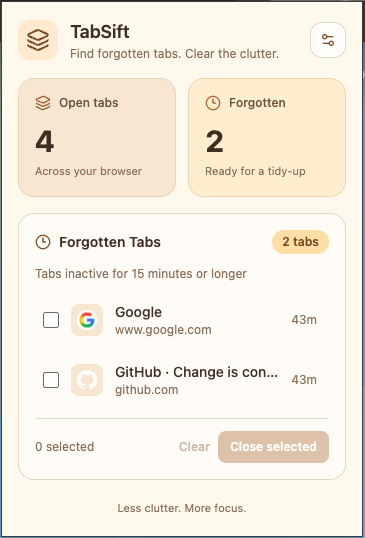
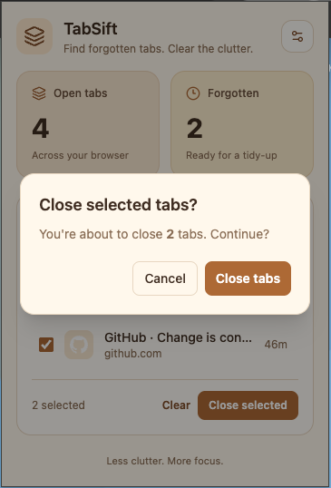
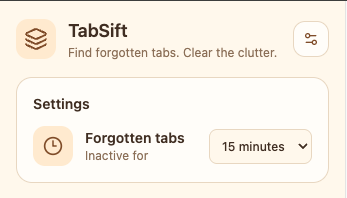

# TabSift

**Find forgotten tabs. Clear the clutter.**

TabSift is a lightweight browser extension that helps you identify inactive tabs and close the ones you no longer need.

Instead of automatically closing your tabs, TabSift gives you control over what stays open and what gets removed.

[Install from Chrome Web Store](https://chromewebstore.google.com/detail/tabsift/jkhicjbejfpnpohgjfkeepcoadjkoelc)

## Features

- **Tab Overview** - See how many tabs are currently open.
- **Forgotten Tab Detection** - Find tabs you haven't visited recently.
- **Custom Inactivity Threshold** - Choose from 5 minutes to 1 day.
- **Safe Tab Cleanup** - Select tabs to close and confirm before removing them.
- **Protected Tabs** - Active, pinned, and audible tabs are excluded from cleanup.
- **Toolbar Badge** - See the number of forgotten tabs without opening the popup.
- **Persistent Settings** - Your selected threshold is saved between sessions.

## Screenshots

### Overview


### Safe Tab Cleanup


### Settings


## Tech Stack

- **TypeScript** — Type-safe application logic
- **WXT** — Browser extension development framework
- **Tailwind CSS v4** — Styling
- **Lucide Icons** — UI icons
- **Browser Extensions API** — Tabs, storage, alarms, and toolbar badge
- **Vitest** — Unit testing

## Getting Started

### Prerequisites

- Node.js
- npm
- Google Chrome or another compatible Chromium browser

### Installation

Clone the repository:

```bash
git clone https://github.com/mahshid/tabsift
cd tabsift
npm install
```

Start the development server:

```bash
npm run dev
```

Follow the WXT development instructions shown in the terminal to load the extension.

### Production Build

```bash
npm run build
```

Alternatively:

```bash
npx wxt build
```

Load the generated Chrome extension directory through `chrome://extensions` using **Load unpacked**.

## How It Works

1. TabSift retrieves the browser's normal-window tabs using the Tabs API.
2. It checks when eligible tabs were last accessed.
3. Tabs inactive for longer than your selected threshold appear in the Forgotten Tabs list.
4. You can choose which tabs to close.
5. Before closing, TabSift validates the selected tabs again and asks for confirmation.

Tabs are never closed automatically.

## Permissions

TabSift uses three browser permissions:

| Permission | Purpose |
|---|---|
| `tabs` | Read tab information and close selected tabs |
| `storage` | Save the inactivity threshold |
| `alarms` | Periodically refresh the toolbar badge |

## Testing

Run the unit tests:

```bash
npx vitest run
```

Check TypeScript types:

```bash
npx wxt prepare
npx tsc --noEmit
```

Build the extension:

```bash
npx wxt build
```

## Current Limitations

- Inactivity is determined using the browser's reported tab access time.
- The toolbar badge refreshes on relevant tab events and periodic alarms, so updates may not be instantaneous.
- The extension currently focuses on identifying and manually closing inactive tabs rather than restoring sessions or automatically suspending tabs.

## Behind the Project

I wrote about the development process, technical decisions,
and lessons learned while building TabSift.

[Read the article on Medium](https://medium.com/@mahshid-hajyani/building-tabsift-the-small-browser-extension-that-taught-me-a-lot-37af7d19ada5)

## Privacy

See the [Privacy Policy](PRIVACY.md) for details.

## License

This project is licensed under the MIT License.
See the [LICENSE](LICENSE) file for details.
